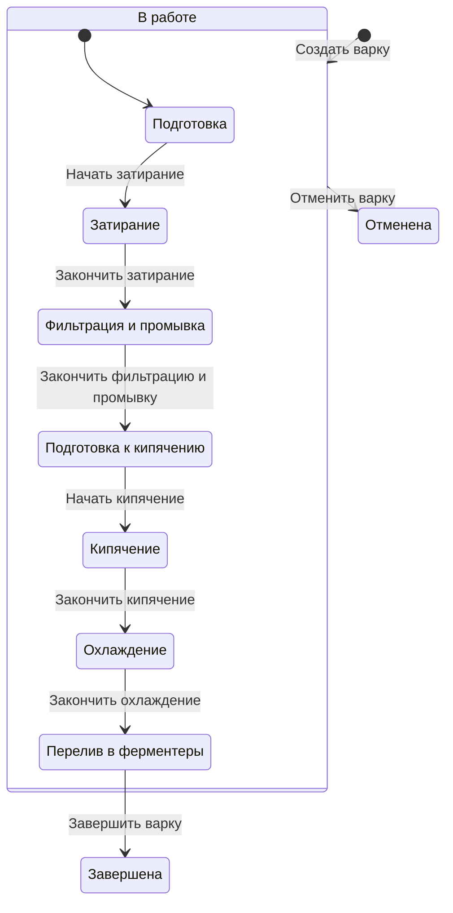

# 1. ha-brewery

## 1.1. Границы предметной области

| Контекст | Владелец | Ответственность |
| --- | --- | --- |
| Рецептура | `ha-brewery` | Хранить канонический рецепт в BeerJSON. В MVP пивовар импортирует рецепт, открывает его на телефоне и получает печатную форму. |
| Варка | `ha-brewery` | Вести конкретную варку по выбранной редакции рецепта. Хранить фактические действия, замеры и объёмы переливов. |
| Брожение | `ha-fermentation` | Вести самостоятельную ферментацию от внесения дрожжей до розлива. Выбирать OG и FG, рассчитывать ABV. |
| Учёт газа | `ha-gas-management` | Вести баллоны, взвешивания и остатки газа. Связь с `ha-brewery` вне MVP. |

### 1.1.1. Читаемые технические имена

У каждой записи встроенного справочника и каждого определения состояния, действия или атрибута процесса есть техническое имя в поле `name`. Это непустая строка из символов `[0-9a-z_]`. Имя уникально в пределах своего справочника или набора однотипных определений процесса. При загрузке конфига ошибка формата или дубликат делает конфиг недействительным. Сообщение об ошибке указывает имя и набор, в котором оно встретилось.

Ссылки в рецепте, конфиге, журнале и API используют значение `name`. Поля `title` и `description` содержат произвольный текст для человека. Их можно менять, сохраняя все ссылки. Опубликованное `name` стабильно: при переименовании нужна миграция существующих ссылок. Для экземпляров варок, переливов и записей журнала сохраняются их собственные идентификаторы.

### 1.1.2. Требования к моделям данных

Первичный контракт формата — JSON Schema Draft 2020-12. Корневые схемы самостоятельно читаемых документов хранятся в `schemas/*.schema.json`. Повторяющиеся внутри документа определения размещаем в `$defs`, общие определения нескольких контрактов подключаем через `$ref`. Бэкенд и фронтенд используют один набор схем и разрешают ссылки локально. Конфиг процесса в YAML валидируется после разбора.

Схема задаёт поля, типы, обязательность, единицы и структурные ограничения. В Markdown остаются назначение, владелец, жизненный цикл, предметные инварианты и сценарии. Уникальность технического имени в коллекции, существование ссылок и допустимость переходов проверяются в доменной логике. Версию сохраняемого формата учитываем при чтении и миграциях, диалект JSON Schema задаём отдельно. Для импорта BeerJSON закрепляем ревизию полного комплекта схем поставщика.

Диалект схемы и версия сохранённого документа меняются независимо. Для импорта BeerJSON закрепляем проверенную ревизию внешних схем. Правила, связывающие документы, включая существование кода BJCP и уникальность технического имени в каталоге, проверяются отдельно от структуры.

[Схемы моделей и физических величин](../custom_components/brewery/schemas/). Измеренные объём, масса, температура, плотность и pH записываются парой значения и единицы. Типы величин и коды единиц берём из [схемы BeerJSON](../custom_components/brewery/schemas/vendor/beerjson/measureable_units.json). Копия схемы поставляется с интеграцией. Валидатор регистрирует её локально по исходному `$id`, поэтому проверка не требует сети. Ограничения на значения задаются там, где используются величины. При суммировании измерения приводятся к общей единице.

При описании и ревью применяем следующие правила.

1. **Один факт — один владелец.** Для каждого сохраняемого поля называем источник и операцию, которая его меняет. Плановая навеска в редакции рецепта и фактически взвешенная масса в журнале — два факта. Предложение калькулятора становится частью плана после принятия пивоваром.
2. **Производные значения воспроизводимы.** Если значение однозначно вычисляется из уже сохранённых данных, описываем входы, формулу и единицу результата в разделе расчёта. Так, порции промывной воды хранятся в журнале, а их сумма доступна карточке и другим интеграциям. Правила пересчёта после исправлений приведены в § 1.6.1.
3. **Идентичность и связи явны.** Для ссылки указываем объект назначения, область уникальности, допустимое количество связей и поведение при изменении объекта. Для определений используем технические имена по § 1.1.1. Экземпляр получает собственный ID, когда его нужно различать, исправлять или адресовать. Два внесения одного хмеля должны различаться, даже если у них совпали время и масса.
4. **Значения однозначно интерпретируются.** Фиксируем единицу, допустимый диапазон и смысл пропуска, нуля или пустой коллекции там, где различие влияет на результат. Дефолт указываем только при наличии предметного правила. Для времени различаем фактический момент действия и порядок, в котором автомат принял переходы. Для коллекции указываем порядок и допустимость повторов, если от них зависит поведение.
5. **История сохраняет смысл.** Ссылка годится, если нужная версия данных останется доступна. Копия нужна, когда данные получают независимый жизненный цикл. При применении шаблона воды цели становятся частью редактируемого рецепта; варка затем ссылается на его неизменяемую редакцию. Для изменения формата описываем чтение ранее сохранённых данных, если меняется их интерпретация.
6. **Границы форматов явны.** Для импорта, хранения и публичного ответа описываем только существенные преобразования. Например, свободное название соли в BeerJSON требует сопоставления с формой из справочника. Подпись кнопки и прогресс нужны клиенту, но не входят в журнал. Отдельное представление вводим, когда у него есть собственные требования.
7. **Инварианты проверяемы.** Рядом с моделью указываем условия, охватывающие несколько полей или записей, и момент проверки. Например, создание варки и закрепление редакции выполняются атомарно. Одни и те же правила действуют при вызове из карточки и через API.

**Критерий избыточности при ревью.** Что потеряет пивовар или интеграция, если удалить поле и заново открыть варку? Если значение восстанавливается однозначно, его вычисляем. Если теряется замер, выбор пользователя, адресуемая связь или возможность воспроизвести закреплённый план, сохраняем его и называем этот сценарий в описании. Тот же вопрос применяем к отдельным объектам: словаря концентраций достаточно, пока отдельному иону не требуется собственный жизненный цикл.

Встроенные справочники хранятся в [data/](../custom_components/brewery/data/). Коэффициенты солей рассчитаны для чистых веществ указанной формы. Для локальной проверки установите зависимости разработки и запустите тот же скрипт, который использует CI.

```sh
python -m pip install -r requirements-dev.txt
python scripts/validate_catalogs.py
```

Проверка использует локальный реестр схем и сверяет редакцию BJCP, коды стилей, идентификаторы записей и порядок границ диапазонов.

## 1.2. Редакции рецепта

У рецепта один рабочий черновик BeerJSON без номера. Первый импорт создаёт черновик. Повторный импорт в тот же рецепт и будущие правки через UI обновляют его на месте.

При создании первой варки черновик фиксируется как неизменяемая редакция № 1. Для каждой следующей варки система сравнивает содержимое черновика с последней редакцией. Если содержимое совпадает, варка ссылается на неё. Если отличается, система фиксирует редакцию со следующим номером, связывает с ней варку и оставляет её копию текущим черновиком. Фиксация редакции и создание варки выполняются одной операцией.

Мобильный экран, печатная форма и плановые позиции журнала конкретной варки используют закреплённую за ней редакцию. Характеристики оборудования, план рецепта и фактические результаты варки учитываются раздельно.

## 1.3. Варка и журнал

Варка моделируется расширенным детерминированным конечным автоматом. Этап задаёт доступные команды. Бэкенд принимает решение по команде, текущему этапу, данным варки и закреплённым правилам процесса. Переход меняет этап. Внутреннее действие добавляет запись в журнал. Например, при внесении хмеля варка остаётся на этапе кипячения, а его длительность по-прежнему отсчитывается от команды «Начать кипячение».

### 1.3.1. Этапы и переходы

У каждого состояния есть техническое имя по [§ 1.1.1](#111-читаемые-технические-имена). В таблице и на диаграмме показаны подписи для пивовара.

| Текущий этап | Команда пивовара | Новый этап |
| --- | --- | --- |
| Создание варки | Создать варку | Подготовка |
| Подготовка | Начать затирание | Затирание |
| Затирание | Закончить затирание | Фильтрация и промывка |
| Фильтрация и промывка | Закончить фильтрацию и промывку | Подготовка к кипячению |
| Подготовка к кипячению | Начать кипячение | Кипячение |
| Кипячение | Закончить кипячение | Охлаждение |
| Охлаждение | Закончить охлаждение | Перелив в ферментеры |
| Перелив в ферментеры | Завершить варку | Завершена |
| Любой из семи рабочих этапов | Отменить варку | Отменена |



В подготовку входят помол, подготовка воды и нагрев заторной воды. После фильтрации пивовар освобождает котёл от дробины, возвращает сусло и нагревает его. Отсчёт кипячения начинается по факту закипания. Вирпул и осаждение относятся к охлаждению. Каждый перелив в ферментер фиксируется отдельно, после последнего пивовар завершает варку явной командой. Оба конечных состояния сохраняют журнал.

**Как читать схему.** Стрелки обозначают команды смены этапа. Действия внутри этапа можно выполнять между переходами. Карточка показывает их рядом с командой перехода.

| Этап | Действия внутри этапа |
| --- | --- |
| Затирание | Отметить внесение солода или кислоты, записать пробу pH |
| Фильтрация и промывка | Внести очередную порцию промывной воды |
| Кипячение | Записать объём в начале и в конце кипа, отметить каждое внесение хмеля |
| Перелив в ферментеры | Записать объём для каждого ферментера |

### 1.3.2. Документ варки

Варка хранится как один логический документ со стабильным идентификатором, ссылкой на редакцию рецепта, версией процесса и журналом. При создании варки закрепляются и рецепт, и правила процесса. Закреплённая версия правил остаётся доступной после обновления интеграции.

Пивовар может оставить комментарий к любой записи или отдельную текстовую заметку в таймлайне. Каждое выполненное действие создаёт одну типизированную запись со своим ID, этапом и фактическим временем, в том числе при вводе задним числом. Запись перехода содержит исходный и новый этапы. Подтверждённый переход атомарно записывается в журнал. Текущий этап определяется последовательностью принятых переходов, начиная с подготовки. Исправление фактического времени меняет хронологию отображения и длительности. Порядок принятых переходов сохраняется независимо от сортировки таймлайна. У планового внесения есть ссылка на позицию закреплённого рецепта. Таймлайн упорядочивается по фактическому времени.

Итоги вычисляются из записей. Два внесения одного хмеля по 15 г дают расход 30 г и сохраняют оба момента внесения. Исправление пробы или объёма обновляет соответствующую запись и зависимые итоги. Длительность текущего этапа вычисляется от момента входа до текущего времени, законченного — по фактическим временам его границ. После рестарта HA интеграция загружает документ и продолжает отсчёт от сохранённого времени.

### 1.3.3. Декларативное описание процесса

Версионируемый конфиг на бэкенде задаёт этапы, переходы и доступные действия. Состояния, действия и атрибуты именуются по [§ 1.1.1](#111-читаемые-технические-имена). Пример описания промывки включён в схему процесса.

Расчёт порции по остатку реализуется один раз обработчиком порционного внесения. Перенос знакомого действия на другой этап, изменение порции или перехода задаются конфигом. Для новой логики добавляется обработчик на бэкенде, для нового вида элемента управления — компонент на фронтенде. Конфиг выбирает поддерживаемые типы и параметры. Mermaid-схема переходов для документации генерируется из того же описания процесса.

### 1.3.4. Экран варки и доступ извне

Бэкенд отдаёт карточке текущий этап, время его начала, рассчитанные показатели и доступные действия с ID, подписями, полями ввода и данными для отображения. Карточка отображает их стандартными кнопками, формами и индикаторами прогресса, отправляет выбранную команду и получает обновления через WebSocket. Одна карточка обслуживает все этапы. Для промывки сервер возвращает фактический и плановый объёмы и подпись кнопки с очередной порцией.

Бэкенд проверяет команду по актуальной версии документа и сохраняет результат до подтверждения. Если телефон и планшет показывают один и тот же остаток, после записи порции с телефона команда со старой версии на планшете вызывает обновление экрана. В журнал попадает одно внесение.

Другие интеграции получают через действия HA предметные данные варки со стабильными идентификаторами (имена состояний и атрибутов — по [§ 1.1.1](#111-читаемые-технические-имена)): этап, замеры, фактические объёмы и ссылки на переливы. Подписи кнопок, формы и оформление прогресса относятся к контракту карточки. Правила обмена приведены в разделе «Контракт между интеграциями».

### 1.3.5. Затирание

Температурную программу исполняет «Хмельница». В журнале отмечаются начало и конец затирания, пробы pH, внесения кислоты и солода.

Старт затирания и внесение солода фиксируются отдельно: у них могут быть разные фактические времена.

### 1.3.6. Промывная вода

На этапе «Фильтрация и промывка» кнопка «Внести 2 л воды» фиксирует добавление промывной воды. Плановый объём берётся из закреплённой редакции рецепта. Прогресс-бар показывает сумму фактических внесений относительно плана, например «4 из 5,5 л». Для каждой записи сохраняются фактическое время и внесённый объём с единицей. Температура воды в журнале не фиксируется.

Объём на кнопке равен меньшему из двух значений: 2 л или остаток до плана. Нажатие добавляет в таймлайн одну запись на показанный объём и обновляет прогресс. При остатке 1,5 л кнопка называется «Внести 1,5 л воды». Когда план достигнут, прогресс-бар остаётся заполненным, а кнопка исчезает. После исправления записи сумма, остаток и видимость кнопки пересчитываются. Внесение воды сохраняет текущий этап варки.

### 1.3.7. Действия с таймингом

Действие с таймингом — отдельный тип действия. У него есть плановая привязка к этапу и фактическое время выполнения. Например, для внесения хмеля сохраняются плановый момент по рецепту, использованный хмель, фактическая масса и время внесения. В MVP о наступлении срока напоминает «Хмельница».

### 1.3.8. Замеры и переливы

Замер плотности хранит исходное показание в шкале BeerJSON (`brix`, `plato` или `sg`), прибор и температуру пробы. Перелив хранит ферментер назначения и фактический объём. Эти же записи используются для просмотра измерений и учёта выхода сусла.

Замеры объёма — внутренние действия текущего этапа. Каждая запись хранит фактическое время и измеренный объём с единицей.

| Этап | Действие | Что измеряется |
| --- | --- | --- |
| Кипячение | Записать объём в начале кипячения | Объём сусла в котле при начале кипения |
| Кипячение | Записать объём в конце кипячения | Объём сусла в котле по окончании кипения, до охлаждения |

Выход в ферментеры определяется суммой объёмов фактических переливов.

## 1.4. Связь с брожением

Сусло одной варки можно распределить между несколькими ферментерами. Каждый перелив можно связать со своей ферментацией. Время перелива и время внесения дрожжей независимы.

Если проба варки используется при определении OG, `ha-brewery` передаёт исходное показание с единицей, прибором и температурой. За выбор OG отвечает `ha-fermentation`. Обе интеграции работают самостоятельно. Переименование сохраняет связь, а её удаление сохраняет историю обеих сторон.

### 1.4.1. Контракт между интеграциями

- Service Registry для команд и запросов между интеграциями.
- State Machine для публикации и чтения телеметрии.
- Event Bus для уведомлений о событиях.

Каждая интеграция владеет собственным хранилищем. Интеграции обмениваются данными через интерфейсы Home Assistant и обращаются только к собственным данным в `.storage`.

## 1.5. Внесения по рецепту

Каждую позицию засыпи пивовар подтверждает отдельно, в том числе когда несколько солодов внесены одновременно. Если один солод указан в рецепте дважды, оба внесения доступны по отдельности. Запись журнала связывается с выбранной позицией зафиксированной редакции рецепта и хранит фактические время и массу. При вводе предлагается плановая масса, которую пивовар может исправить. Внеплановое внесение записывается без ссылки на позицию.

Для внесения с таймингом мобильный экран и печатная форма показывают привязку из BeerJSON, например «через 10 минут от начала второй паузы». Если фактическое начало паузы неизвестно, время остаётся относительным. При отсутствии тайминга позиция показывается без назначенного времени. Подтверждение внесения создаёт одну запись журнала.

### 1.5.1. Водоподготовка и справочник солей

Основа — вода обратного осмоса. У рецепта один целевой минеральный профиль для заторной и промывной воды. Вся подготовленная вода, включая запас для промывки, получает одинаковую дозу каждой соли на литр.

| Назначение | Объём для расчёта навесок | План внесения воды |
| --- | --- | --- |
| Заторная вода | Объём по рецепту | Весь подготовленный объём |
| Промывная вода | Объём по рецепту плюс запас | Объём по рецепту |

Например, при плане промывки 8 л и запасе 2 л навески рассчитываются на 10 л. Цель прогресс-бара и кнопки порционного внесения в § 1.3.6 остаётся равной 8 л.

Встроенный справочник `salts.json` поставляется с интеграцией и обновляется вместе с ней. Для каждой химической формы соли в нём предусмотрена своя запись с именем по [§ 1.1.1](#111-читаемые-технические-имена). Например, `calcium_chloride_anhydrous` и `calcium_chloride_dihydrate` различают безводный хлорид кальция и дигидрат. Ссылка на форму однозначно определяет, какой состав использовать при расчёте навески. Справочник обслуживается в конфиге без внешней интеграции и пользовательского редактора.

Пример записи для чистого дигидрата приведён в схеме солей.

При дозировке 0,10 г/л эта форма вносит 27,3 мг/л кальция и 48,2 мг/л хлорида. Для расчёта достаточно коэффициентов в мг/г.

### 1.5.2. Калькулятор водоподготовки

Калькулятор работает с водой до контакта с засыпью. Для исходного осмоса принимаем нулевой вклад по учитываемым ионам. Целевые концентрации задаются в рецепте в мг/л и одинаковы для заторной и промывной воды. Пропущенная цель означает, что концентрацию этого иона пивовар не задал. Явный ноль означает цель 0 мг/л.

BJCP 2021 даёт качественные ориентиры для отдельных стилей. Например, для Czech Pale Lager указана мягкая вода с низким содержанием сульфатов и карбонатов. В Vital Statistics приведены показатели пива. Стандартной таблицы целевых концентраций ионов по стилям в руководстве нет. Выбор стиля оставляет числовые цели рецепта за пивоваром. [BJCP 2021, стиль 3A](https://www.bjcp.org/style/2021/3/3A/czech-pale-lager/)

| Режим | Вход | Результат |
| --- | --- | --- |
| Прямой расчёт | Дозировка каждой выбранной формы соли, г/л | Расчётный профиль воды в мг/л и навески на подготовленные объёмы в граммах |
| Обратный расчёт | Целевые концентрации и выбранные формы солей | Предлагаемые неотрицательные дозировки, получаемый профиль и отклонение от каждой заданной цели |

Для прямого расчёта справочник задаёт вклад каждого иона в мг на грамм конкретной формы соли. Концентрация иона равна сумме произведений дозировок солей (г/л) на соответствующий вклад (мг/г). Масса каждой соли равна её дозировке, умноженной на объём подготовки. Экран показывает навески для заторной воды, промывной воды с запасом и суммарно. Например, при 20 л заторной воды, 8 л промывной и 2 л запаса дозировка 0,20 г/л даёт 4,00 г и 2,00 г соответственно, всего 6,00 г.

Одна соль может вносить сразу несколько ионов. Поэтому подобранные дозировки проверяются тем же прямым расчётом. Для каждого иона экран показывает расчётное значение, а при заданной цели — также цель и разницу в мг/л. Если точное совпадение недостижимо, пивовар видит, какие цели расходятся с результатом. Критерий подбора задан в § 1.5.2.1.

Пивовар указывает доступные формы солей. При подборе по целевому профилю калькулятор находит доступные формы по `base_salt_name`. Единственную форму выбирает автоматически, а из нескольких берёт первую в порядке предпочтения пивовара. В план внесения записывается конкретное `name`. Последующее изменение предпочтений сохраняет форму и навеску в закреплённой редакции начатой варки.

#### 1.5.2.1. Баланс масс и подбор навесок

Пусть `A[i,j]` — вклад иона i в мг на грамм формы соли j из `ions.values` (мг иона на грамм соли), `m[j]` — навеска в граммах, `V > 0` — объём обрабатываемой воды в литрах. Прямой расчёт даёт `c[i] = c₀[i] + Σ A[i,j] × m[j] / V` в мг/л. Для осмоса принимаем `c₀ = 0`. При общем целевом профиле достаточно один раз найти дозировки `x[j]` в г/л и умножить их на подготовляемый объём каждой порции воды.

Расчёт описывает номинальный состав воды после полного растворения солей при указанных формах и до контакта с засыпью. Для мела в обычной воде это допущение неприменимо. Для мела справочник задаёт `ions: null`. Автоподбор использует формы с числовыми коэффициентами. При импорте навеска мела сохраняется в рецепте с пометкой о неопределённом вкладе. Модель pH и карбонатного равновесия в эту формулу не входит. [Растворимость мела, Bru’n Water](https://www.brunwater.com/water-knowledge)

Обратный расчёт использует неотрицательные наименьшие квадраты (NNLS), метод активного набора. Столбцы матрицы соответствуют доступным формам солей, строки целевой функции — заданным ионам.

Для каждого иона с заданной целью `t[i]` определяем масштаб `d[i] = max(t[i], s)`. Параметр `s` общий для всех ионов, стартовое значение — 10 мг/л. При неотрицательных дозировках `x[j] ≥ 0` минимизируем сумму квадратов нормированных ошибок:

`J = Σ ((c[i] − t[i]) / d[i])²`, где `c = c₀ + A·x`.

Перед вызовом NNLS делим строку `A[i,:]` и соответствующую правую часть `t[i] − c₀[i]` на один и тот же `d[i]`. Веса определяются целями по ионам. Выбор формы соли влияет на состав столбца матрицы.

**Проверка.** При целях 50 и 150 мг/л отклонения на 5 и 15 мг/л дают одинаковый вклад в штраф: 0,01 каждое. При явной цели 0 мг/л и расчётной концентрации 1 мг/л вклад также равен 0,01. При пустом поле строка исключается из подбора, а экран показывает рассчитанную концентрацию. Любое отклонение от заданной цели учитывается, в том числе при концентрациях ниже 10 мг/л.

Если все цели пусты, команда подбора недоступна. При нескольких оптимальных решениях допустима любая оптимальная смесь; порядок столбцов фиксируется по техническому имени. [Описание NNLS](https://docs.scipy.org/doc/scipy/reference/generated/scipy.optimize.nnls.html)

Подбор ведётся без промежуточного округления. После перевода дозировок в граммы навески для каждой ёмкости округляются до шага весов (для текущей установки 0,01 г). Профиль и отклонения на экране пересчитываются по показанным навескам и объёму соответствующей ёмкости. Гарантия минимума относится к непрерывным дозировкам до округления.

### 1.5.3. Импорт воды и навесок из BeerJSON

| Поле в `recipe.ingredients` | Как использовать при импорте |
| --- | --- |
| `water_additions[]` | Импортировать ионный состав указанной воды и её объём, если задан. У записи нет признака целевого профиля после внесения солей. Числовую цель калькулятора пивовар задаёт явно. |
| `miscellaneous_additions[]` с `type: "water agent"` | Сохранить название, количество с единицей и указанный `timing`. Для соли с заданной массой это плановая навеска. Назначение `add_to_mash` относится к затору. Отдельного значения `add_to_sparge` в `timing.use` нет. |

Название добавки в BeerJSON — свободный текст. Для расчёта импортёр сопоставляет его с конкретной формой из `salts.json`. Если исходная форма известна, при замене на доступную форму с тем же `base_salt_name` масса пересчитывается с сохранением вклада ионов. Например, 1,00 г чистого безводного CaCl₂ соответствует примерно 1,32 г чистого CaCl₂·2H₂O.

Если в рецепте указано только «Calcium Chloride, 1 г», импорт сохраняет исходное название и навеску. Для расчёта ионного вклада или эквивалентной замены пивовар уточняет форму из рецепта. Выбор имеющейся формы в настройках сам по себе эту неопределённость не снимает.

Схемы BeerJSON: [состав воды](https://www.beerjson.org/water.json.html), [добавки](https://www.beerjson.org/misc.json.html), [этап внесения](https://www.beerjson.org/timing.json.html).

### 1.5.4. Справочник целевых профилей воды

Справочник профилей воды поставляется с интеграцией. У каждой рекомендации есть источник. При обновлении справочника коды подходящих стилей сверяются с каталогом указанной редакции BJCP. Все концентрации одного профиля используют общую единицу из записи справочника. При применении шаблона калькулятор приводит концентрации к мг/л.

Для авторских профилей берём концентрации из опубликованного рецепта пивовара. Указываем только ионы, для которых есть числовые значения. При применении такого профиля остальные поля целей очищаются. Например, Джейк Гарднер указывает для Spirit of the West кальций 109, сульфаты 150 и хлориды 89 мг/л. [Рецепт Westbound & Down](https://www.beerandbrewing.com/recipe-westbound-down-spirit-of-the-west)

Привязка к стилю означает, что источник рекомендует профиль для такого пива или описывает его использование в конкретном рецепте. Код выбирается по названию и описанию стиля в BJCP. Пустой массив означает, что конкретный стиль для этой записи не установлен. Стиль рецепта позволяет показать подходящие шаблоны; применение остаётся явной командой. [Редакции BJCP](https://www.bjcp.org/bjcp-style-guidelines/)

Если импорт однозначно передал цели, калькулятор открывает их как есть. Состав исходной воды из `water_additions` сам по себе целью не считается (§ 1.5.3). При отсутствии целей поля остаются пустыми. Пивовар может ввести значения вручную или выбрать профиль из списка и нажать «Применить профиль». Только эта команда заменяет текущие цели черновика значениями шаблона.

После применения каждый ион редактируется независимо. Поле можно очистить, чтобы снять цель, или указать явный ноль. Рецепт хранит собственные целевые концентрации; совпадение со справочником произвольное. Изменение справочника в новом релизе сохраняет цели уже созданных рецептов и редакций варок.

**Проверка.** Применение «Светлое охмелённое» задаёт 150 мг/л сульфатов и 50 мг/л хлоридов. Пивовар меняет сульфаты на 120 мг/л. После повторного открытия рецепта калькулятор использует 120 и 50 мг/л, а при выборе шаблона в другой варке предлагает исходные 150 и 50 мг/л.

## 1.6. Исправления и сохранность журнала

Пивовар может внести действие задним числом и исправить ошибочное время, количество или показание в существующей записи. Исправление обновляет таймлайн и зависящие от записи итоги. Например, изменение перелива с 14 до 13 л уменьшает общий учтённый выход на 1 л. Исходный план рецепта сохраняется.

`ha-brewery` хранит рецепты, редакции начатых варок, журнал и связи переливов с ферментациями независимо от срока истории Recorder. После перезапуска HA пивовар может продолжить текущую варку или открыть завершённую с её исходным планом и фактическими результатами.

### 1.6.1. Нормализация состояния

Хранилище содержит первичные факты варки и данные, необходимые для их интерпретации: закреплённые редакции, идентификаторы и связи, переходы, фактическое время, исходные показания и количество с единицей для каждого внесения или перелива. Внесённый объём промывной воды — сумма фактических порций.

Суммы, расчётные остатки, длительности, проценты выполнения, следующая порция и доступность кнопки вычисляются в памяти из актуального документа и закреплённого плана. Эти показатели исключены из сохраняемого документа. Для зависящих от времени показателей расчёт получает момент наблюдения явным параметром.

После каждой принятой правки бэкенд заново вычисляет показатели по всем соответствующим записям. Добавление задним числом, исправление и загрузка после рестарта используют те же функции. Предыдущие итоги и разница между старым и новым значением в расчёте не участвуют. Проверка команд, карточка и ответы другим интеграциям используют общие правила расчёта и согласованную версию варки.

**Критерий приёмки.** При одинаковых первичных фактах, плане, правилах процесса и моменте наблюдения результаты совпадают независимо от истории исправлений и перезапусков. При плане промывки 5,5 л порции 2 + 2 + 1,5 л дают полный прогресс. Исправление первой порции на 1 л даёт 4,5 л, остаток 1 л и кнопку «Внести 1 л воды» на этапе промывки. Повторный пересчёт и загрузка того же документа дают тот же результат. Восстановление исходного значения возвращает полный прогресс.

Та же проверка распространяется на другие этапы. Если после начала охлаждения исправить одно из двух внесений хмеля с 15 до 10 г, расход составит 25 г, в таймлайне останутся две записи, а текущим этапом останется охлаждение. Если исправить объём перелива, изменится общий выход в ферментеры.

## 1.7. Каталог стилей BJCP

Интеграция поставляет статический файл `bjcp-2021.json` по [BJCP Beer Style Guidelines 2021](https://www.bjcp.org/style/guidelines-2021/) и обновляет его вместе с релизом. В каталоге есть коды и названия категорий и стилей, включая локальные стили из приложения B, а также числовые диапазоны OG и FG в SG, IBU, SRM и ABV в процентах. Описания стилей и прочие текстовые разделы руководства в каталог не входят.

Параметры без фиксированного диапазона опускаются. Если руководство задаёт диапазоны отдельно для вариантов, каталог хранит эти диапазоны раздельно. У нескольких вариантов может быть общий код BJCP, например 21B или 27A. Для различения вариантов используется название вместе с кодом и редакцией руководства.

### 1.7.1. Диапазоны стиля на экране рецепта

Под каждым целевым показателем рецепта выводится подпись с диапазоном выбранного стиля BJCP в тех же единицах, что и целевое значение. Например, под целью «10 IBU» отображается «BJCP 1A · 8–12 IBU». Подписи позволяют пивовару визуально сверить цели рецепта с параметрами стиля.

Если стиль не указан или для показателя нет диапазона, подпись скрывается. Выход за диапазон допускается при импорте и использовании рецепта.

## 1.8. Границы MVP

Редактор рецептов в интерфейсе отложен. В MVP рецепт создаётся и обновляется импортом BeerJSON.

Статус следующих пунктов из раннего объёма MVP ещё предстоит согласовать:

- Экспорт BeerJSON и требования к валидации при импорте.
- Каталоги сырья.
- Расчёты OG, FG, ABV, IBU и EBC, масштабирование рецепта.
- Профили оборудования и водный баланс.
- Включение режимов калькулятора водоподготовки из § 1.5.2 в MVP.
- Технологические карты и чек-листы операций.
